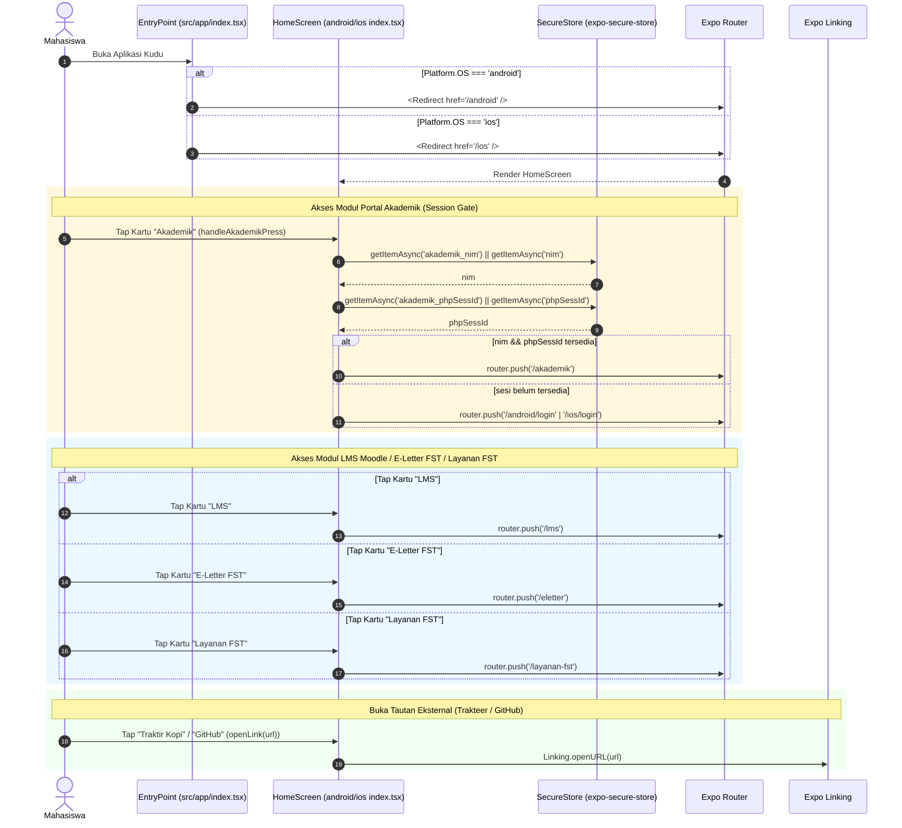
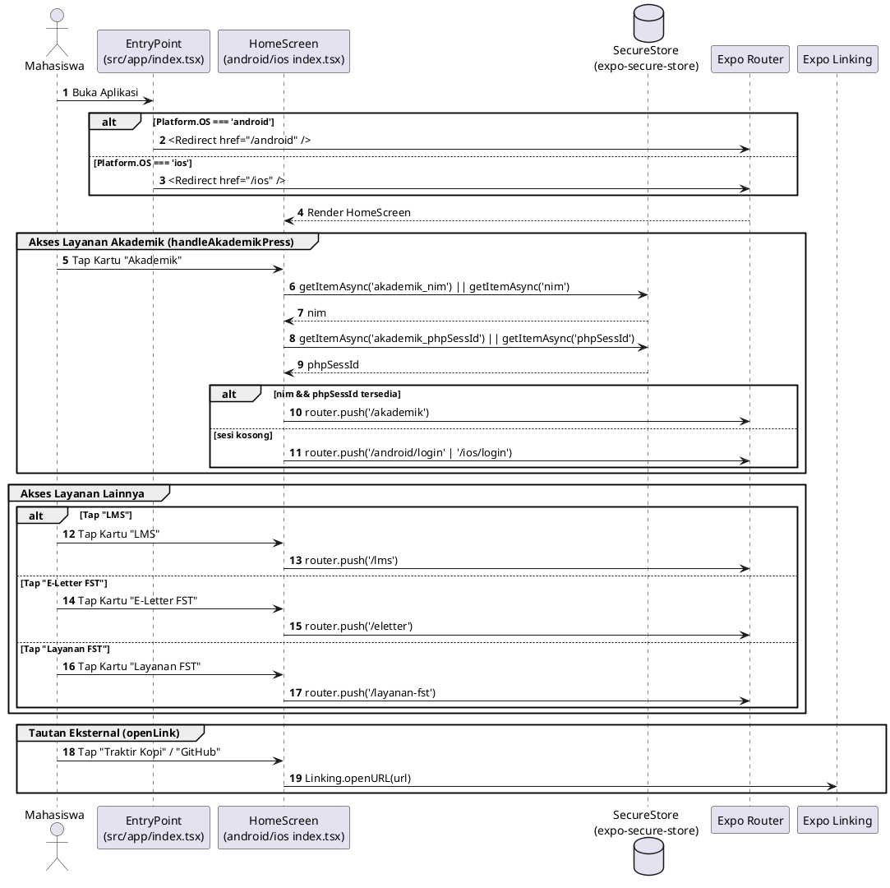

# Sequence Diagram — Modul 1: Home & Navigasi (`home`)

## Referensi Kode Sumber
- `src/app/index.tsx` (`EntryPoint`)
- `src/app/android/index.tsx` & `src/app/ios/index.tsx` (`HomeScreen`, `handleAkademikPress`, `openLink`)
- `src/app/layanan-fst.tsx` (`LayananFSTScreen`)

---

## 1. Alur Buka Aplikasi, Cek Sesi Akademik, & Navigasi Modul (Mermaid)

---

## 2. Diagram (PlantUML)

