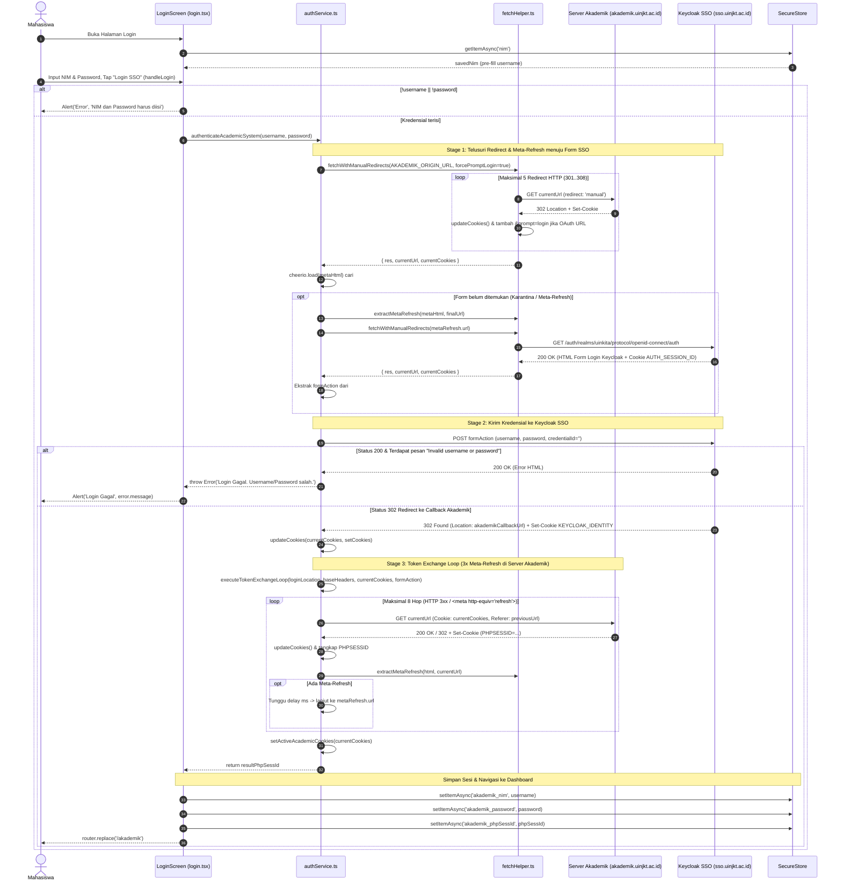
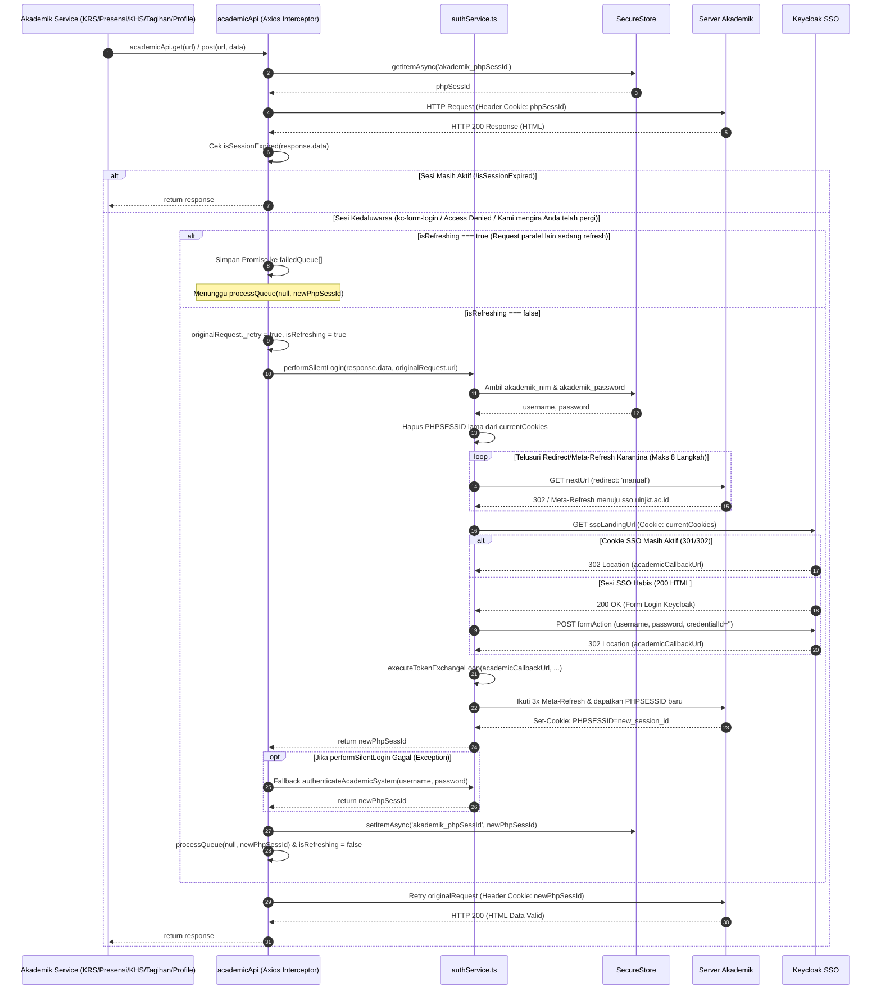
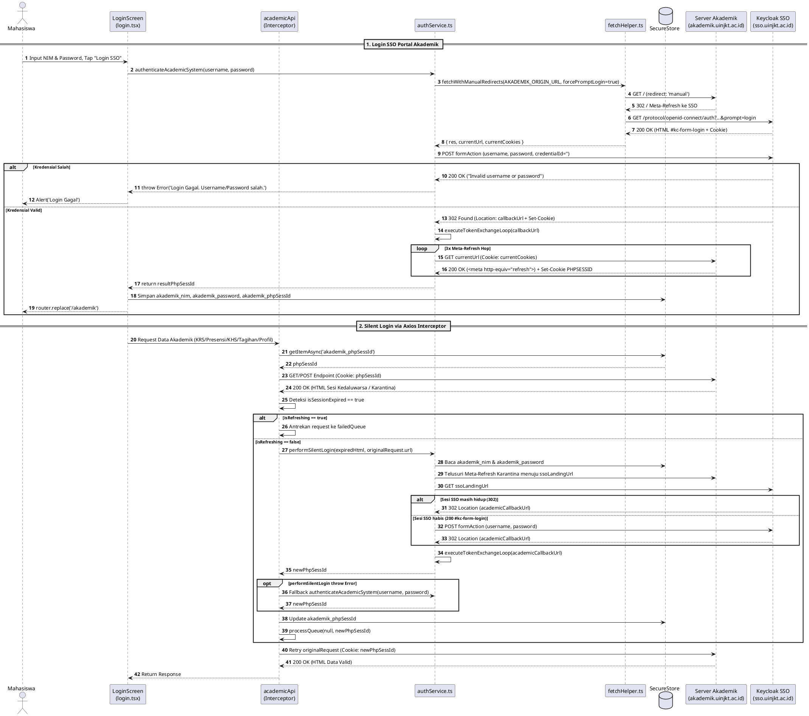

# Sequence Diagram — Modul 2A: Autentikasi SSO & Silent Login Akademik (`akademik-auth`)

## Referensi Kode Sumber
- `src/app/android/login.tsx` & `src/app/ios/login.tsx` (`LoginScreen`, `handleLogin`)
- `src/services/akademik/authService.ts` (`authenticateAcademicSystem`, `performSilentLogin`, `executeTokenExchangeLoop`)
- `src/services/akademik/fetchHelper.ts` (`fetchWithManualRedirects`, `extractMetaRefresh`)
- `src/services/akademik/academicApi.ts` (Axios Request/Response Interceptors, `isRefreshing`, `failedQueue`, `processQueue`)
- `src/utils/cookieUtils.ts` (`extractSetCookies`, `updateCookies`)

---

## 1. Alur Login SSO Portal Akademik (`authenticateAcademicSystem`)

---

## 2. Alur Silent Login & Queue Interceptor (`academicApi` & `performSilentLogin`)

---

## 3. Diagram (PlantUML)

