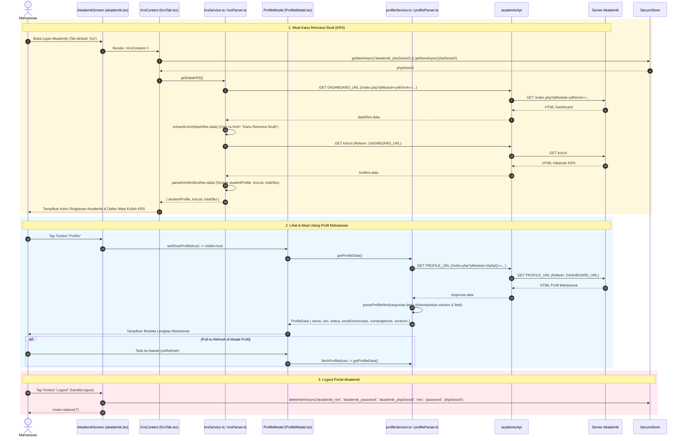
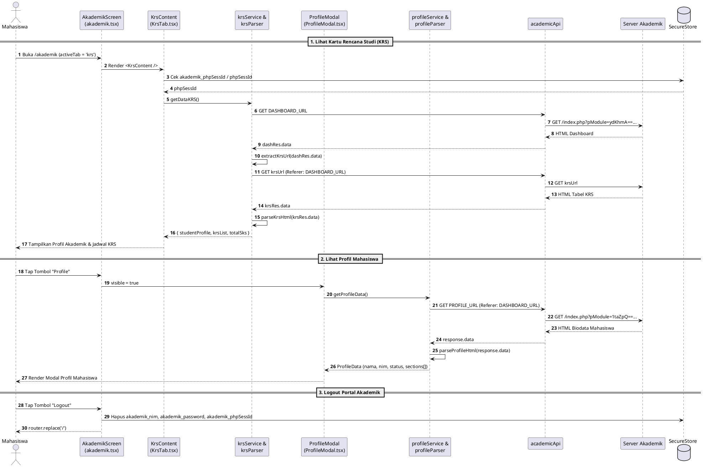

# Sequence Diagram — Modul 2B: KRS, Profil Mahasiswa & Logout (`akademik-krs-profile`)

## Referensi Kode Sumber
- `src/app/akademik.tsx` (`AkademikScreen`, `handleLogout`)
- `src/components/akademik/KrsTab.tsx` (`KrsContent`)
- `src/services/akademik/krsService.ts` (`getDataKRS`) & `src/services/akademik/krsParser.ts` (`extractKrsUrl`, `parseKrsHtml`)
- `src/components/akademik/ProfileModal.tsx` (`ProfileModal`)
- `src/services/akademik/profileService.ts` (`getProfileData`) & `src/services/akademik/profileParser.ts` (`parseProfileHtml`)

---

## 1. Alur Lihat Kartu Rencana Studi (KRS), Profil Mahasiswa & Logout (Mermaid)

---

## 2. Diagram (PlantUML)

