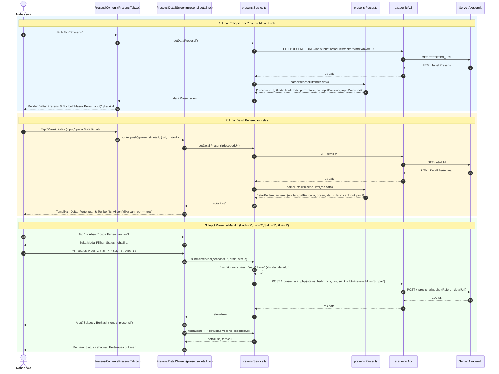
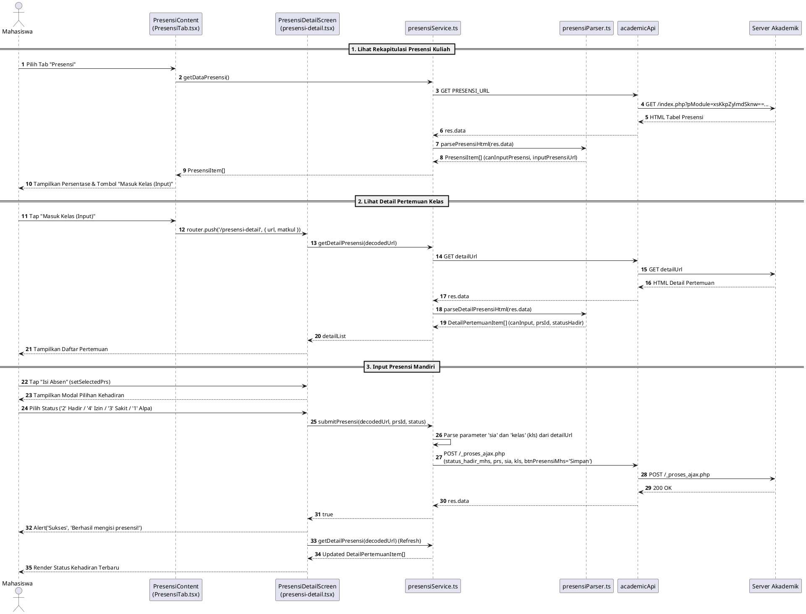

# Sequence Diagram — Modul 2C: Presensi & Input Absen Mandiri (`akademik-presensi`)

## Referensi Kode Sumber
- `src/components/akademik/PresensiTab.tsx` (`PresensiContent`)
- `src/app/presensi-detail.tsx` (`PresensiDetailScreen`, `fetchDetail`, `executeSubmit`)
- `src/services/akademik/presensiService.ts` (`getDataPresensi`, `getDetailPresensi`, `submitPresensi`)
- `src/services/akademik/presensiParser.ts` (`parsePresensiHtml`, `parseDetailPresensiHtml`)

---

## 1. Alur Lihat Rekap Presensi, Detail Pertemuan & Input Absen Mandiri (Mermaid)

---

## 2. Diagram (PlantUML)

