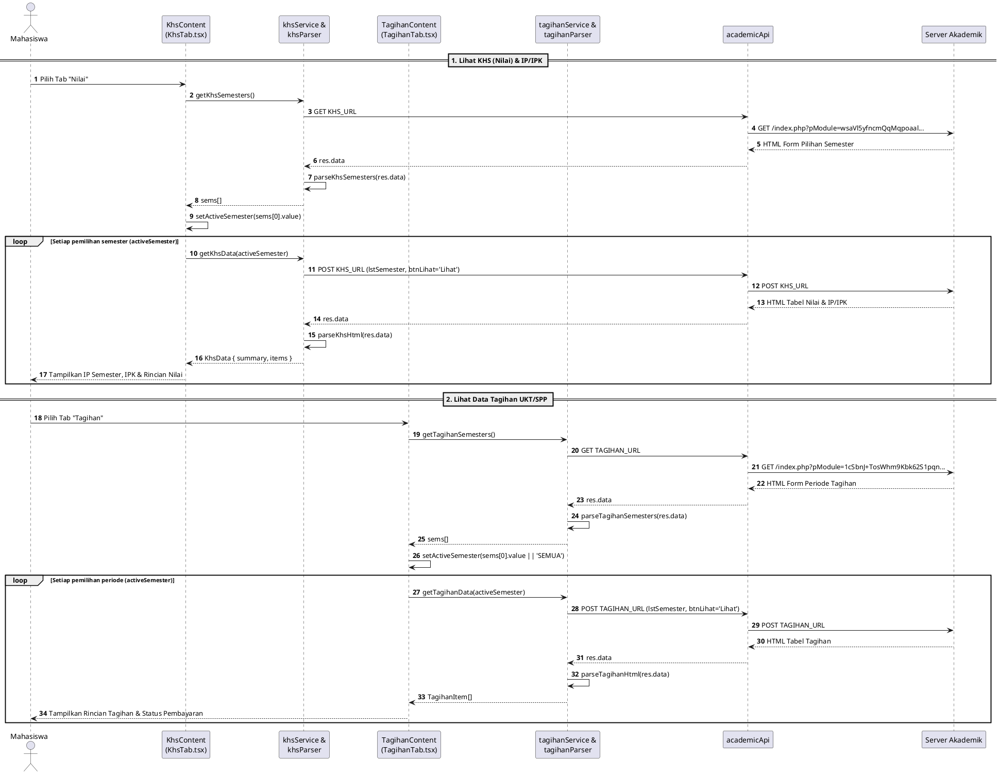

# Sequence Diagram — Modul 2D: KHS (Nilai) & Tagihan UKT (`akademik-khs-tagihan`)

## Referensi Kode Sumber
- `src/components/akademik/KhsTab.tsx` (`KhsContent`)
- `src/services/akademik/khsService.ts` (`getKhsSemesters`, `getKhsData`) & `src/services/akademik/khsParser.ts` (`parseKhsSemesters`, `parseKhsHtml`)
- `src/components/akademik/TagihanTab.tsx` (`TagihanContent`)
- `src/services/akademik/tagihanService.ts` (`getTagihanSemesters`, `getTagihanData`) & `src/services/akademik/tagihanParser.ts` (`parseTagihanSemesters`, `parseTagihanHtml`)

---

## 1. Alur Lihat KHS (Nilai) & Tagihan UKT per Semester (Mermaid)

```mermaid
sequenceDiagram
    autonumber
    actor User as Mahasiswa
    participant KhsUI as KhsContent (KhsTab.tsx)
    participant KhsSvc as khsService.ts / khsParser.ts
    participant TagUI as TagihanContent (TagihanTab.tsx)
    participant TagSvc as tagihanService.ts / tagihanParser.ts
    participant Api as academicApi
    participant Akd as Server Akademik

    rect rgb(235, 248, 255)
        Note over User,Akd: 1. Lihat Kartu Hasil Studi (KHS / Nilai)
        User->>KhsUI: Pilih Tab "Nilai"
        KhsUI->>KhsSvc: getKhsSemesters()
        KhsSvc->>Api: GET KHS_URL (/index.php?pModule=wsaVl5yfncmQqMqpoaal...)
        Api->>Akd: GET KHS_URL
        Akd-->>Api: HTML Halaman KHS
        Api-->>KhsSvc: res.data
        KhsSvc->>KhsSvc: parseKhsSemesters(res.data) (Scrape <select name="lstSemester">)
        KhsSvc-->>KhsUI: KhsSemesterOption[]
        KhsUI->>KhsUI: setActiveSemester(sems[0].value)

        loop Saat activeSemester berubah (Initial load / Tap Chip Semester)
            KhsUI->>KhsSvc: getKhsData(activeSemester)
            KhsSvc->>Api: POST KHS_URL (lstSemester=activeSemester, btnLihat='Lihat')
            Api->>Akd: POST KHS_URL (Referer: KHS_URL)
            Akd-->>Api: HTML Tabel Nilai & Ringkasan IP/IPK
            Api-->>KhsSvc: res.data
            KhsSvc->>KhsSvc: parseKhsHtml(res.data)
            KhsSvc-->>KhsUI: KhsData { summary (IP, IPK, SKS), items[] (Formatif, UTS, UAS, Nilai Akhir) }
            KhsUI-->>User: Render Ringkasan IP/IPK & Kartu Nilai Mata Kuliah
        end
    end

    rect rgb(255, 248, 220)
        Note over User,Akd: 2. Lihat Data Tagihan UKT/SPP
        User->>TagUI: Pilih Tab "Tagihan"
        TagUI->>TagSvc: getTagihanSemesters()
        TagSvc->>Api: GET TAGIHAN_URL (/index.php?pModule=1cSbnJ+TosWhm9Kbk62S1pqn...)
        Api->>Akd: GET TAGIHAN_URL
        Akd-->>Api: HTML Halaman Tagihan
        Api-->>TagSvc: res.data
        TagSvc->>TagSvc: parseTagihanSemesters(res.data) (Scrape <select name="lstSemester">)
        TagSvc-->>TagUI: TagihanSemesterOption[]
        TagUI->>TagUI: setActiveSemester(sems[0].value || 'SEMUA')

        loop Saat activeSemester berubah (Initial load / Tap Pill Periode)
            TagUI->>TagSvc: getTagihanData(activeSemester)
            TagSvc->>Api: POST TAGIHAN_URL (lstSemester=activeSemester, btnLihat='Lihat')
            Api->>Akd: POST TAGIHAN_URL (Referer: TAGIHAN_URL)
            Akd-->>Api: HTML Tabel Pembayaran
            Api-->>TagSvc: res.data
            TagSvc->>TagSvc: parseTagihanHtml(res.data)
            TagSvc-->>TagUI: TagihanItem[] (noTagihan, jenisPembayaran, totalTagihan, potongan, sisaTagihan, status)
            TagUI-->>User: Render Kartu Rincian Tagihan & Badge Status Lunas/Belum Bayar
        end
    end
```

---

## 2. Diagram (PlantUML)

