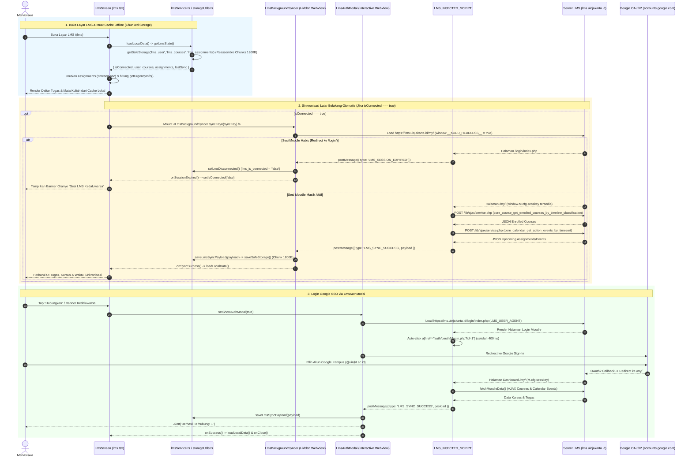
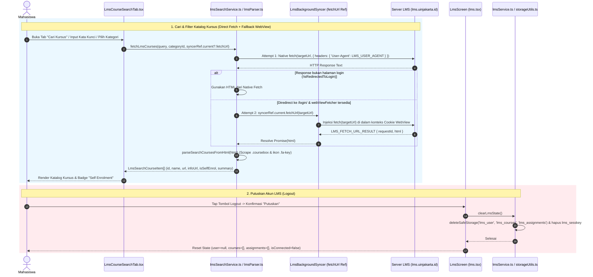
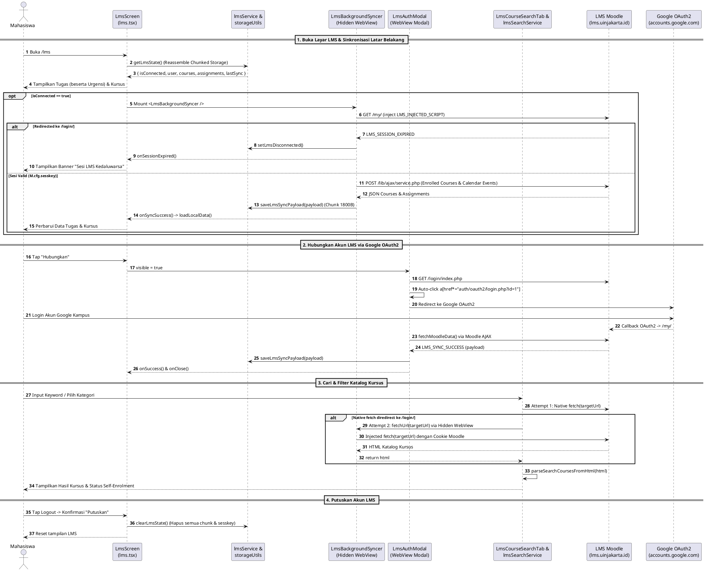

# Sequence Diagram — Modul 3: LMS Moodle (`lms`)

## Referensi Kode Sumber
- `src/app/lms.tsx` (`LmsScreen`, `loadLocalData`, `handleRefresh`, `handleLogout`)
- `src/components/lms/LmsAuthModal.tsx` (`LmsAuthModal`)
- `src/components/lms/LmsBackgroundSyncer.tsx` (`LmsBackgroundSyncer`, `fetchUrl`)
- `src/components/lms/LmsCourseSearchTab.tsx` (`LmsCourseSearchTab`, `executeSearch`)
- `src/services/lms/lmsService.ts` (`getLmsState`, `saveLmsSyncPayload`, `setLmsDisconnected`, `clearLmsState`)
- `src/services/lms/lmsInjectedScript.ts` (`LMS_INJECTED_SCRIPT`, `fetchMoodleData`)
- `src/services/lms/lmsSearchService.ts` (`fetchLmsCourses`) & `src/services/lms/lmsParser.ts` (`parseSearchCoursesFromHtml`, `getUrgencyInfo`)
- `src/utils/storageUtils.ts` (`saveSafeStorage`, `getSafeStorage`, `deleteSafeStorage`)

---

## 1. Alur Muat Cache Lokal, Headless Background Sync & Login Google OAuth2 (Mermaid)

---

## 2. Alur Cari & Filter Katalog Kursus + Putuskan Akun LMS (Mermaid)

---

## 3. Diagram (PlantUML)

