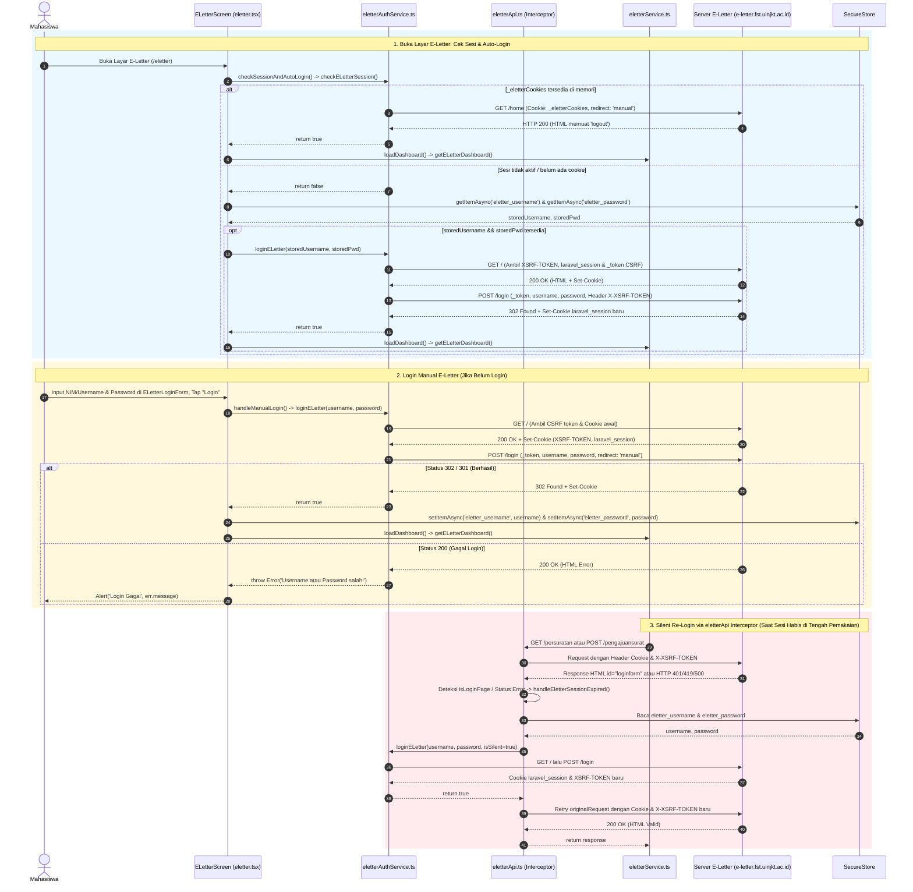
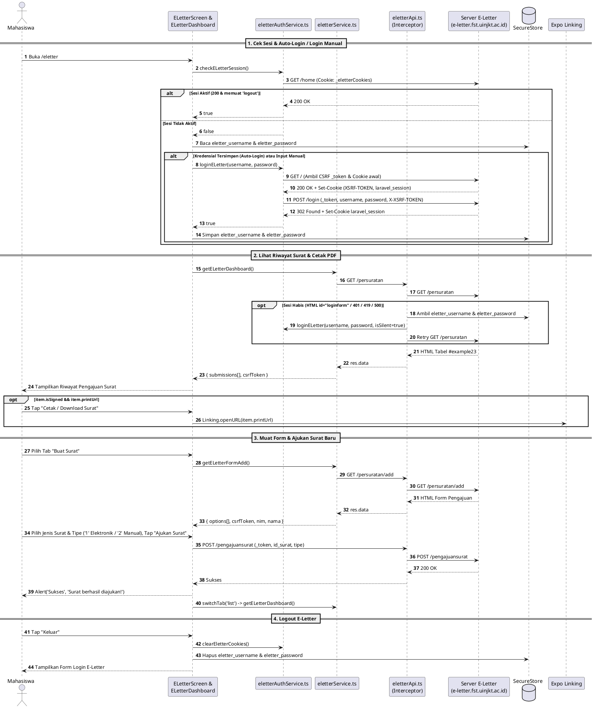

# Sequence Diagram — Modul 4: E-Letter FST (`eletter`)

## Referensi Kode Sumber
- `src/app/eletter.tsx` (`ELetterScreen`, `checkSessionAndAutoLogin`, `handleManualLogin`, `loadDashboard`, `loadFormAdd`, `submitPengajuan`, `handleLogout`)
- `src/components/eletter/ELetterLoginForm.tsx` (`ELetterLoginForm`)
- `src/components/eletter/ELetterDashboard.tsx` (`ELetterDashboard`)
- `src/services/eletter/eletterAuthService.ts` (`checkELetterSession`, `loginELetter`, `clearEletterCookies`)
- `src/services/eletter/eletterApi.ts` (Axios Request/Response Interceptors, `handleEletterSessionExpired`)
- `src/services/eletter/eletterService.ts` (`getELetterDashboard`, `getELetterFormAdd`)

---

## 1. Alur Cek Sesi, Auto-Login, Login Manual & Silent Re-Login (Mermaid)

---

## 2. Alur Lihat Riwayat Surat, Cetak PDF, Ajukan Surat Baru & Logout (Mermaid)

```mermaid
sequenceDiagram
    autonumber
    actor User as Mahasiswa
    participant Screen as ELetterScreen / ELetterDashboard
    participant Svc as eletterService.ts
    participant Api as eletterApi.ts
    participant Server as Server E-Letter
    participant Linking as Expo Linking
    participant Store as SecureStore

    rect rgb(235, 248, 255)
        Note over User,Linking: 1. Lihat Riwayat Surat & Cetak PDF (Tab 'list')
        Screen->>Svc: loadDashboard() -> getELetterDashboard()
        Svc->>Api: GET /persuratan
        Api->>Server: GET /persuratan
        Server-->>Api: HTML Dashboard Persuratan
        Api-->>Svc: res.data
        Svc->>Svc: cheerio.load() parse table#example23 tbody tr
        Svc-->>Screen: { submissions[], csrfToken }
        Screen-->>User: Render Daftar Riwayat Surat & Status Tanda Tangan

        opt Surat Telah Ditandatangani (item.isSigned && item.printUrl)
            User->>Screen: Tap "Cetak / Download Surat"
            Screen->>Linking: Linking.openURL(item.printUrl)
        end
    end

    rect rgb(240, 255, 240)
        Note over User,Server: 2. Muat Form & Ajukan Surat Baru (Tab 'add')
        User->>Screen: Pilih Tab "Buat Surat" (switchTab('add'))
        Screen->>Svc: loadFormAdd() -> getELetterFormAdd()
        Svc->>Api: GET /persuratan/add
        Api->>Server: GET /persuratan/add
        Server-->>Api: HTML Form Pengajuan
        Api-->>Svc: res.data
        Svc->>Svc: Scrape <select name="id_surat">, meta csrf-token, NIM & Nama
        Svc-->>Screen: { options[], csrfToken, nim, nama }
        Screen-->>User: Tampilkan Pilihan Jenis Surat & Tipe Tanda Tangan

        User->>Screen: Pilih Jenis Surat, Pilih Tipe ('1' Elektronik / '2' Manual), Tap "Ajukan Surat"
        Screen->>Api: POST /pengajuansurat (_token, id_surat, tipe, Referer: /persuratan/add)
        Api->>Server: POST /pengajuansurat
        Server-->>Api: 200 OK / Redirect
        Api-->>Screen: Sukses
        Screen-->>User: Alert('Sukses', 'Surat berhasil diajukan!')
        Screen->>Screen: switchTab('list') -> loadDashboard()
    end

    rect rgb(255, 248, 220)
        Note over User,Store: 3. Logout E-Letter
        User->>Screen: Tap Tombol "Keluar" (handleLogout)
        Screen->>Screen: clearEletterCookies()
        Screen->>Store: deleteItemAsync('eletter_username') & deleteItemAsync('eletter_password')
        Screen-->>User: Kembali ke ELetterLoginForm (isLoggedIn = false)
    end
```

---

## 3. Diagram (PlantUML)

