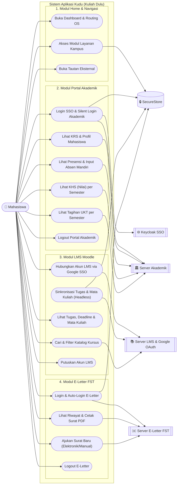
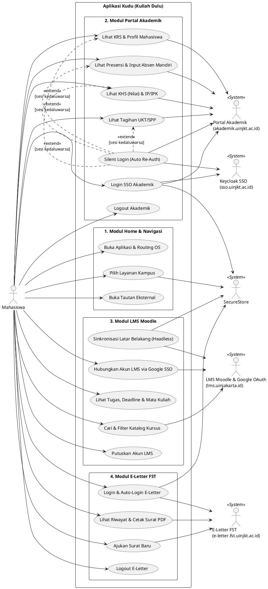

# Use Case Diagram — Global System Overview (Kudu)

Dokumen ini menggambarkan **Use Case Diagram Keseluruhan Sistem** pada aplikasi **Kudu (`com.ryyzdev.kudu`)** yang menyatukan 4 modul utama: **Home & Navigasi**, **Portal Akademik (e-Semesta & SSO)**, **LMS Moodle**, dan **E-Letter FST**.

## Daftar Aktor

| Aktor | Tipe | Deskripsi |
| :--- | :--- | :--- |
| **Mahasiswa** | Primary Actor | Pengguna utama aplikasi Kudu untuk mengakses layanan kampus UIN Syarif Hidayatullah Jakarta. |
| **SecureStore (Lokal)** | Secondary Actor | Penyimpanan terenkripsi lokal (`expo-secure-store` & `storageUtils.ts`) untuk kredensial, token sesi, dan cache chunked. |
| **Keycloak SSO Server** | Secondary Actor | Server autentikasi tunggal UIN Jakarta (`sso.uinjkt.ac.id`). |
| **Portal Akademik Server** | Secondary Actor | Server AIS / e-Semesta (`akademik.uinjkt.ac.id`) penyedia data KRS, Presensi, KHS, Tagihan, dan Profil. |
| **LMS Moodle & Google OAuth** | Secondary Actor | Server e-learning (`lms.uinjakarta.id`) dan Google OAuth2 (`accounts.google.com`). |
| **E-Letter FST Server** | Secondary Actor | Server persuratan Fakultas Sains dan Teknologi (`e-letter.fst.uinjkt.ac.id`). |

---

## Diagram (Mermaid)

---

## Diagram (PlantUML)

