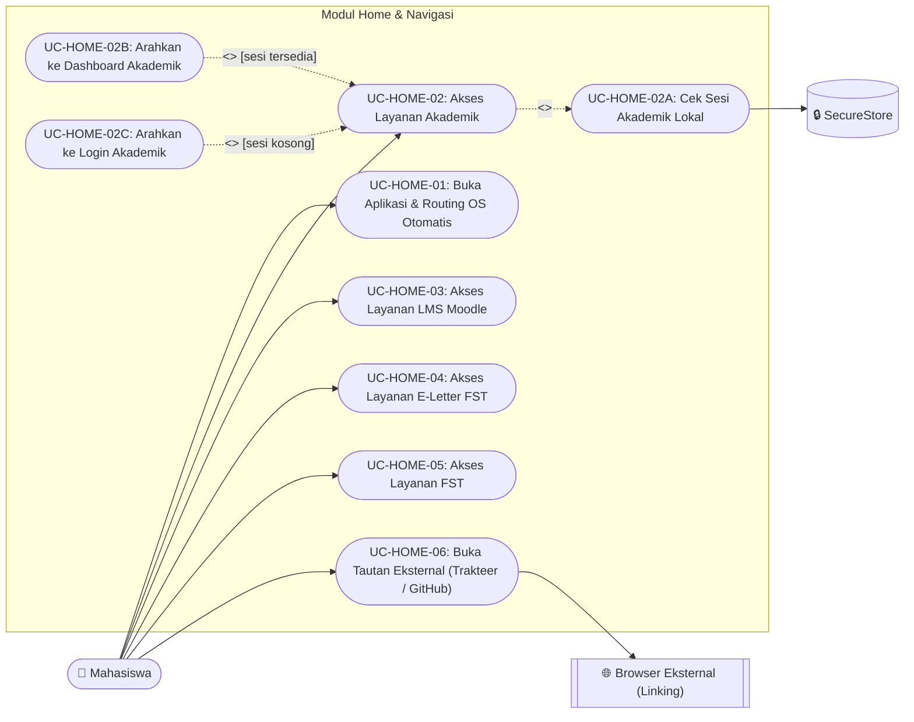
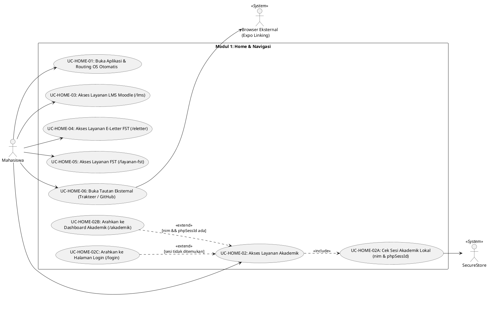

# Use Case Diagram — Modul 1: Home & Navigasi (`home`)

## Referensi Kode Sumber
- `src/app/_layout.tsx`
- `src/app/index.tsx` (`EntryPoint`)
- `src/app/android/index.tsx` & `src/app/ios/index.tsx` (`HomeScreen`)
- `src/app/layanan-fst.tsx` (`LayananFSTScreen`)

## Spesifikasi Use Case

| ID | Nama Use Case | Aktor | Relasi (`<<include>>` / `<<extend>>`) | Deskripsi Logika |
| :--- | :--- | :--- | :--- | :--- |
| **UC-HOME-01** | Buka Aplikasi & Routing OS Otomatis | Mahasiswa | - | `EntryPoint` memeriksa `Platform.OS` dan mengarahkan ke `/android` atau `/ios`. |
| **UC-HOME-02** | Akses Layanan Akademik | Mahasiswa, SecureStore | `<<include>>` **UC-HOME-02A** `<<extend>>` **UC-HOME-02B**, **UC-HOME-02C** | Saat kartu "Akademik" ditekan, aplikasi memeriksa keberadaan sesi Akademik di penyimpanan lokal. |
| **UC-HOME-02A** | Cek Sesi Akademik Lokal | SecureStore | Included by **UC-HOME-02** | Membaca `akademik_nim` (`nim`) dan `akademik_phpSessId` (`phpSessId`) dari `SecureStore`. |
| **UC-HOME-02B** | Arahkan ke Dashboard Akademik | Mahasiswa | Extends **UC-HOME-02** `[nim && phpSessId tersedia]` | Navigasi langsung ke `/akademik`. |
| **UC-HOME-02C** | Arahkan ke Login Akademik | Mahasiswa | Extends **UC-HOME-02** `[sesi belum ada]` | Navigasi ke `/android/login` atau `/ios/login`. |
| **UC-HOME-03** | Akses Layanan LMS Moodle | Mahasiswa | - | Navigasi ke layar `/lms`. |
| **UC-HOME-04** | Akses Layanan E-Letter FST | Mahasiswa | - | Navigasi ke layar `/eletter`. |
| **UC-HOME-05** | Akses Layanan FST | Mahasiswa | - | Navigasi ke layar `/layanan-fst` (halaman informasi fitur segera hadir). |
| **UC-HOME-06** | Buka Tautan Eksternal (Trakteer / GitHub) | Mahasiswa, Browser Eksternal | - | Memanggil `Linking.openURL()` untuk membuka halaman Trakteer atau repositori GitHub. |

---

## Diagram (Mermaid)

---

## Diagram (PlantUML)

