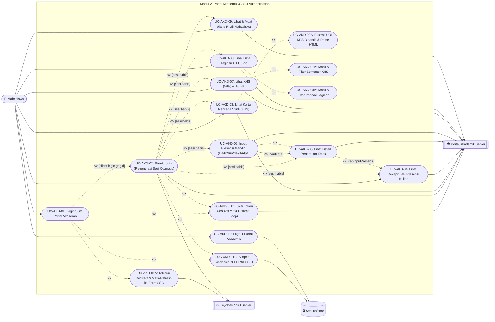
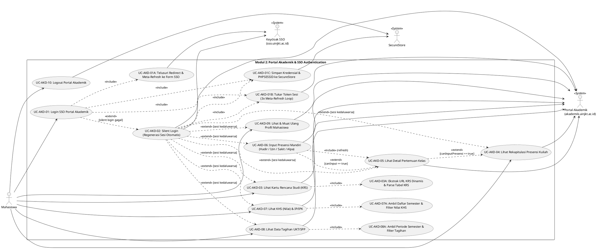

# Use Case Diagram — Modul 2: Portal Akademik & Autentikasi SSO (`akademik`)

## Referensi Kode Sumber
- **Screens**: `src/app/android/login.tsx`, `src/app/ios/login.tsx`, `src/app/akademik.tsx`, `src/app/presensi-detail.tsx`
- **Components**: `src/components/akademik/NavigationTabs.tsx`, `KrsTab.tsx`, `PresensiTab.tsx`, `KhsTab.tsx`, `TagihanTab.tsx`, `ProfileModal.tsx`
- **Services**: `src/services/akademik/academicApi.ts`, `authService.ts`, `fetchHelper.ts`, `krsService.ts`, `krsParser.ts`, `presensiService.ts`, `presensiParser.ts`, `khsService.ts`, `khsParser.ts`, `tagihanService.ts`, `tagihanParser.ts`, `profileService.ts`, `profileParser.ts`

## Spesifikasi Use Case

| ID | Nama Use Case | Aktor | Relasi (`<<include>>` / `<<extend>>`) | Deskripsi Logika |
| :--- | :--- | :--- | :--- | :--- |
| **UC-AKD-01** | Login SSO Portal Akademik | Mahasiswa, Keycloak SSO, Server Akademik, SecureStore | `<<include>>` **UC-AKD-01A**, **UC-AKD-01B**, **UC-AKD-01C** | Autentikasi NIM & Password melalui `authenticateAcademicSystem()`. |
| **UC-AKD-01A** | Telusuri Redirect & Meta-Refresh Form SSO | Keycloak SSO, Server Akademik | Included by **UC-AKD-01** | Menjalankan `fetchWithManualRedirects` & `extractMetaRefresh` hingga menemukan `#kc-form-login`. |
| **UC-AKD-01B** | Tukar Token Sesi (3x Meta-Refresh Loop) | Server Akademik | Included by **UC-AKD-01**, **UC-AKD-02** | Menjalankan `executeTokenExchangeLoop()` untuk menukar kode OAuth menjadi `PHPSESSID`. |
| **UC-AKD-01C** | Simpan Kredensial & Sesi ke SecureStore | SecureStore | Included by **UC-AKD-01**, **UC-AKD-02** | Menyimpan `akademik_nim`, `akademik_password`, dan `akademik_phpSessId`. |
| **UC-AKD-02** | Silent Login (Regenerasi Sesi Otomatis) | Keycloak SSO, Server Akademik, SecureStore | `<<extend>>` dari **UC-AKD-03..09** `[isSessionExpired]` `<<include>>` **UC-AKD-01B**, **UC-AKD-01C** `<<extend>>` **UC-AKD-01** `[jika silent login gagal]` | Interceptor `academicApi` mendeteksi HTML sesi habis, menjalankan `performSilentLogin()`, dan mengulang request yang tertunda di `failedQueue`. |
| **UC-AKD-03** | Lihat Kartu Rencana Studi (KRS) | Mahasiswa, Server Akademik | `<<include>>` Ekstrak URL KRS Dinamis (`extractKrsUrl`) & Parse HTML KRS (`parseKrsHtml`) | Mengambil halaman dashboard untuk mengekstrak URL KRS dinamis lalu merender jadwal & total SKS. |
| **UC-AKD-04** | Lihat Rekapitulasi Presensi Kuliah | Mahasiswa, Server Akademik | - | Mengambil persentase kehadiran, jumlah hadir/alpa, dan status tombol "Masuk Kelas (Input)". |
| **UC-AKD-05** | Lihat Detail Pertemuan Kelas | Mahasiswa, Server Akademik | `<<extend>>` dari **UC-AKD-04** `[canInputPresensi == true]` | Menampilkan daftar pertemuan per mata kuliah beserta status kehadiran & dosen pengampu. |
| **UC-AKD-06** | Input Presensi Mandiri (Hadir/Izin/Sakit/Alpa) | Mahasiswa, Server Akademik | `<<extend>>` dari **UC-AKD-05** `[canInput == true]` `<<include>>` **UC-AKD-05** (Refresh) | Mengirim POST ke `/_proses_ajax.php` (`submitPresensi`) dengan kode status (`2`, `4`, `3`, `1`). |
| **UC-AKD-07** | Lihat Kartu Hasil Studi (KHS / Nilai) & IP/IPK | Mahasiswa, Server Akademik | `<<include>>` Ambil Daftar Semester (`getKhsSemesters`) & Filter Nilai per Semester (`getKhsData`) | Menampilkan nilai Formatif, UTS, UAS, Nilai Akhir, IP Semester, dan IPK. |
| **UC-AKD-08** | Lihat Data Tagihan UKT/SPP | Mahasiswa, Server Akademik | `<<include>>` Ambil Periode Semester (`getTagihanSemesters`) & Filter Tagihan (`getTagihanData`) | Menampilkan rincian tagihan, potongan, sisa tagihan, dan status lunas/belum bayar. |
| **UC-AKD-09** | Lihat & Muat Ulang Profil Mahasiswa | Mahasiswa, Server Akademik | - | Membuka `ProfileModal` dan melakukan scraping biodata mahasiswa (`getProfileData`). |
| **UC-AKD-10** | Logout Portal Akademik | Mahasiswa, SecureStore | - | Menghapus seluruh kunci kredensial & sesi Akademik dari `SecureStore` dan kembali ke `/`. |

---

## Diagram (Mermaid)

---

## Diagram (PlantUML)

