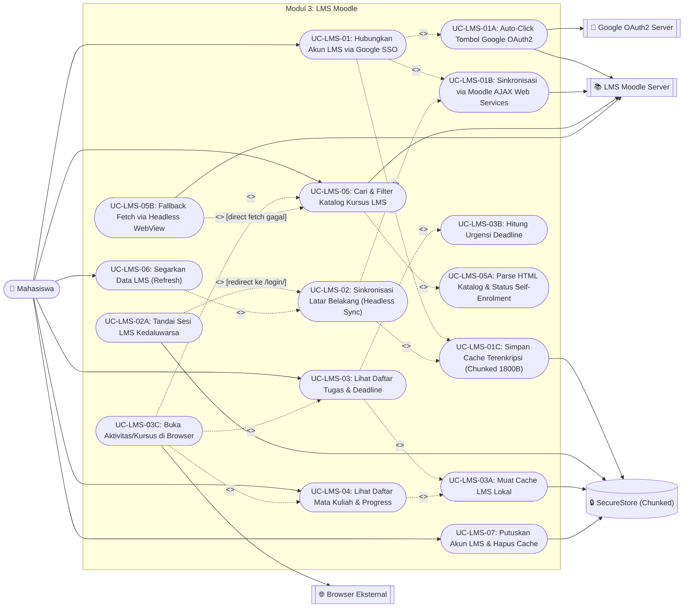
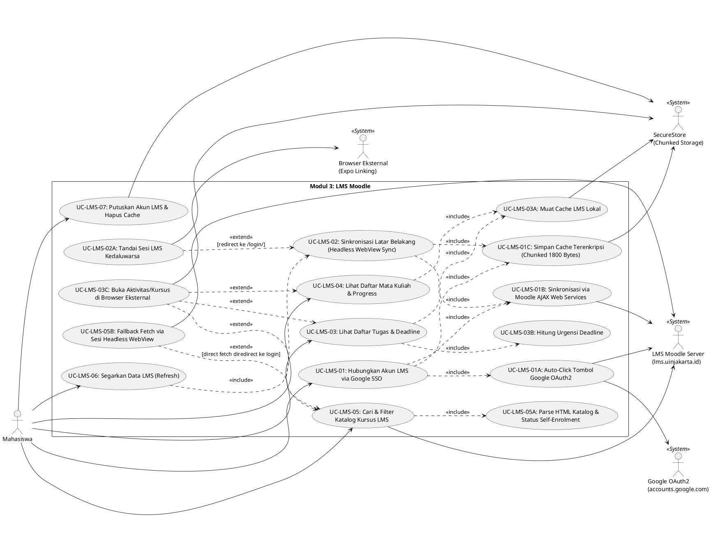

# Use Case Diagram — Modul 3: LMS Moodle (`lms`)

## Referensi Kode Sumber
- **Screen**: `src/app/lms.tsx` (`LmsScreen`)
- **Components**: `src/components/lms/LmsAuthModal.tsx`, `src/components/lms/LmsBackgroundSyncer.tsx`, `src/components/lms/LmsCourseSearchTab.tsx`
- **Services & Utils**: `src/services/lms/lmsService.ts`, `lmsInjectedScript.ts`, `lmsSearchService.ts`, `lmsParser.ts`, `lmsTypes.ts`, `src/utils/storageUtils.ts`

## Spesifikasi Use Case

| ID | Nama Use Case | Aktor | Relasi (`<<include>>` / `<<extend>>`) | Deskripsi Logika |
| :--- | :--- | :--- | :--- | :--- |
| **UC-LMS-01** | Hubungkan Akun LMS via Google SSO | Mahasiswa, Google OAuth2, Server LMS, SecureStore | `<<include>>` **UC-LMS-01A**, **UC-LMS-01B**, **UC-LMS-01C** | Membuka `LmsAuthModal` (`WebView`) untuk login SSO Google dan menyinkronkan data Moodle. |
| **UC-LMS-01A** | Auto-Click Tombol Google OAuth2 | Server LMS, Google OAuth2 | Included by **UC-LMS-01** | `LMS_INJECTED_SCRIPT` mendeteksi halaman `/login/index.php` dan mengeksekusi klik otomatis pada `a[href*="auth/oauth2/login.php?id=1"]`. |
| **UC-LMS-01B** | Sinkronisasi Data via Moodle AJAX Web Services | Server LMS | Included by **UC-LMS-01**, **UC-LMS-02** | Memanggil `core_course_get_enrolled_courses_by_timeline_classification` dan `core_calendar_get_action_events_by_timesort` menggunakan `M.cfg.sesskey`. |
| **UC-LMS-01C** | Simpan Cache Terenkripsi (Chunked Storage) | SecureStore | Included by **UC-LMS-01**, **UC-LMS-02** | `saveLmsSyncPayload` memecah JSON besar menjadi potongan 1800 karakter via `saveSafeStorage`. |
| **UC-LMS-02** | Sinkronisasi Latar Belakang Otomatis (Headless Sync) | Server LMS, SecureStore | `<<include>>` **UC-LMS-01B**, **UC-LMS-01C** `<<extend>>` **UC-LMS-02A** `[redirect ke /login/]` | `LmsBackgroundSyncer` menjalankan WebView tersembunyi (0x0 px) saat `isConnected == true`. |
| **UC-LMS-02A** | Deteksi Sesi LMS Kedaluwarsa | SecureStore | Extends **UC-LMS-02** | Mengirim `LMS_SESSION_EXPIRED`, memanggil `setLmsDisconnected()`, dan menampilkan banner peringatan oranye tanpa menghapus cache tugas offline. |
| **UC-LMS-03** | Lihat Daftar Tugas & Deadline | Mahasiswa, SecureStore | `<<include>>` **UC-LMS-03A**, **UC-LMS-03B** `<<extend>>` **UC-LMS-03C** | Menampilkan daftar tugas diurutkan berdasarkan tenggat waktu terdekat. |
| **UC-LMS-03A** | Muat Cache LMS Lokal (Reassembly Chunks) | SecureStore | Included by **UC-LMS-03**, **UC-LMS-04** | Memanggil `getLmsState()` → `getSafeStorage()` untuk menyatukan kembali chunk data dari `SecureStore`. |
| **UC-LMS-03B** | Hitung Urgensi Deadline Tugas | - | Included by **UC-LMS-03** | `getUrgencyInfo(timesort)` mengklasifikasikan tugas ke `overdue`, `critical` (≤24 jam), `warning` (≤3 hari), atau `normal`. |
| **UC-LMS-03C** | Buka Aktivitas di Browser Eksternal | Mahasiswa, Browser Eksternal | Extends **UC-LMS-03**, **UC-LMS-04**, **UC-LMS-05** | Membuka URL tugas/mata kuliah melalui `Linking.openURL()`. |
| **UC-LMS-04** | Lihat Daftar Mata Kuliah Terdaftar & Progress | Mahasiswa, SecureStore | `<<include>>` **UC-LMS-03A** `<<extend>>` **UC-LMS-03C** | Menampilkan kartu mata kuliah beserta progress bar persentase penyelesaian. |
| **UC-LMS-05** | Cari & Filter Katalog Kursus LMS | Mahasiswa, Server LMS | `<<include>>` **UC-LMS-05A** `<<extend>>` **UC-LMS-05B** `[fetch langsung diredirect ke login]` | Mencari kursus berdasarkan kata kunci atau kategori (`Semua`, `Wajib`, `Pilihan`, `MOOCs`, `Magang / PKL`, `Tugas Akhir`, `Praktikum`, `KKN / PkM`). |
| **UC-LMS-05A** | Parse HTML Katalog & Status Self-Enrolment | - | Included by **UC-LMS-05** | `parseSearchCoursesFromHtml` mengekstrak `.coursebox` dan mendeteksi ikon `.fa-key` (`isSelfEnrol`). |
| **UC-LMS-05B** | Fallback Fetch via Sesi Headless WebView | Server LMS | Extends **UC-LMS-05** | Memanggil `syncerRef.current.fetchUrl(targetUrl)` di dalam konteks cookie WebView jika `fetch()` native ditolak server. |
| **UC-LMS-06** | Segarkan Data LMS (Refresh) | Mahasiswa | `<<include>>` **UC-LMS-02** `[jika terhubung]` atau **UC-LMS-01** `[jika terputus]` | Menambah `syncKey` untuk memuat ulang `LmsBackgroundSyncer` atau membuka modal login. |
| **UC-LMS-07** | Putuskan Akun LMS (Logout & Hapus Cache) | Mahasiswa, SecureStore | - | Memanggil `clearLmsState()` untuk menghapus seluruh chunk `lms_user`, `lms_courses`, `lms_assignments`, dan `lms_sesskey`. |

---

## Diagram (Mermaid)

---

## Diagram (PlantUML)

