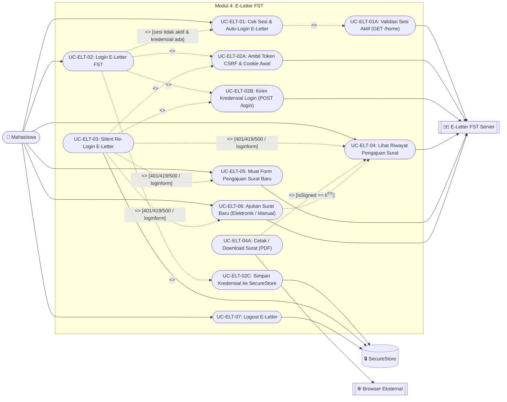
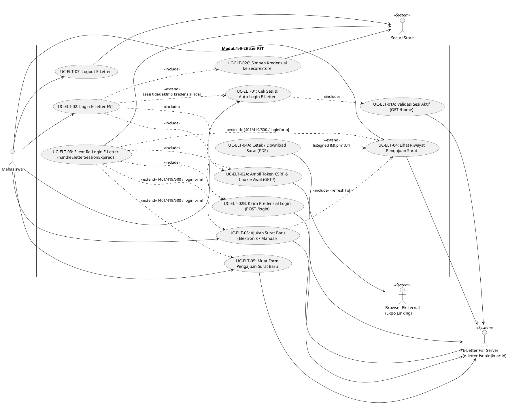

# Use Case Diagram — Modul 4: E-Letter FST (`eletter`)

## Referensi Kode Sumber
- **Screen**: `src/app/eletter.tsx` (`ELetterScreen`)
- **Components**: `src/components/eletter/ELetterLoginForm.tsx`, `src/components/eletter/ELetterDashboard.tsx`
- **Services**: `src/services/eletter/eletterAuthService.ts`, `src/services/eletter/eletterApi.ts`, `src/services/eletter/eletterService.ts`

## Spesifikasi Use Case

| ID | Nama Use Case | Aktor | Relasi (`<<include>>` / `<<extend>>`) | Deskripsi Logika |
| :--- | :--- | :--- | :--- | :--- |
| **UC-ELT-01** | Cek Sesi & Auto-Login E-Letter | Mahasiswa, Server E-Letter, SecureStore | `<<include>>` **UC-ELT-01A** `<<extend>>` **UC-ELT-02** `[sesi habis & kredensial tersimpan]` | Saat layar `/eletter` dibuka, memeriksa sesi aktif terlebih dahulu sebelum mencoba login otomatis. |
| **UC-ELT-01A** | Validasi Sesi Aktif (`GET /home`) | Server E-Letter | Included by **UC-ELT-01** | `checkELetterSession()` memeriksa apakah cookie memori masih valid dan respons `/home` memuat teks `logout`. |
| **UC-ELT-02** | Login E-Letter FST | Mahasiswa, Server E-Letter, SecureStore | `<<include>>` **UC-ELT-02A**, **UC-ELT-02B**, **UC-ELT-02C** | Melakukan autentikasi ke server Laravel E-Letter FST (`loginELetter`). |
| **UC-ELT-02A** | Ambil Token CSRF & Cookie Awal (`GET /`) | Server E-Letter | Included by **UC-ELT-02** | Mengambil `XSRF-TOKEN`, `laravel_session`, dan `<meta name="csrf-token">` / `<input name="_token">`. |
| **UC-ELT-02B** | Kirim Kredensial Login (`POST /login`) | Server E-Letter | Included by **UC-ELT-02** | Mengirim `_token`, `username`, `password` serta header `X-XSRF-TOKEN` dengan `redirect: 'manual'`. |
| **UC-ELT-02C** | Simpan Kredensial ke SecureStore | SecureStore | Included by **UC-ELT-02** | Menyimpan `eletter_username` dan `eletter_password` ke `SecureStore`. |
| **UC-ELT-03** | Silent Re-Login E-Letter (Pemulihan Sesi) | Server E-Letter, SecureStore | `<<extend>>` dari **UC-ELT-04**, **UC-ELT-05**, **UC-ELT-06** `[status 401/419/500 atau HTML loginform]` `<<include>>` **UC-ELT-02A**, **UC-ELT-02B** | Interceptor `eletterApi` (`handleEletterSessionExpired`) melakukan login ulang di latar belakang dan mengulang request yang gagal. |
| **UC-ELT-04** | Lihat Riwayat Pengajuan Surat | Mahasiswa, Server E-Letter | `<<include>>` Parse Tabel `#example23` `<<extend>>` **UC-ELT-04A** `[isSigned && printUrl]` | Mengambil halaman `/persuratan` (`getELetterDashboard`) dan menampilkan daftar status pengajuan surat. |
| **UC-ELT-04A** | Cetak / Download Surat (PDF) | Mahasiswa, Browser Eksternal | Extends **UC-ELT-04** | Membuka URL cetak PDF (`/cetak/...`) melalui `Linking.openURL()` jika surat telah ditandatangani. |
| **UC-ELT-05** | Muat Form Pengajuan Surat Baru | Mahasiswa, Server E-Letter | - | Mengambil `/persuratan/add` (`getELetterFormAdd`) untuk mengekstrak opsi `<select name="id_surat">`, token CSRF, NIM, dan Nama. |
| **UC-ELT-06** | Ajukan Surat Baru (Elektronik / Manual) | Mahasiswa, Server E-Letter | `<<include>>` **UC-ELT-04** (Refresh Riwayat) | Mengirim `POST /pengajuansurat` dengan `_token`, `id_surat`, dan `tipe` (`1` Elektronik / `2` Manual), lalu kembali ke tab Riwayat. |
| **UC-ELT-07** | Logout E-Letter | Mahasiswa, SecureStore | - | Menghapus `_eletterCookies` di memori serta `eletter_username` dan `eletter_password` dari `SecureStore`. |

---

## Diagram (Mermaid)

---

## Diagram (PlantUML)

